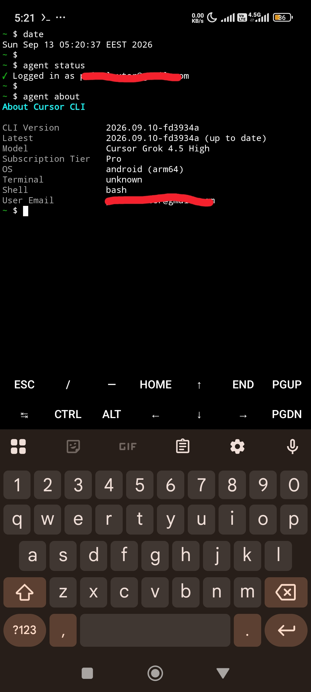

# termux-cursor

[](LICENSE)
[](#prerequisites)
[](#ci--version-caching)

Run **Cursor Agent CLI** natively on **Termux (Android ARM64)** — no proot, no
container, no glibc userland.

<p align="center">
  
</p>

## Quick Start

```bash
# 1. Install prerequisites
pkg update && pkg install -y nodejs-lts curl git ripgrep clang make python binutils

# 2. Clone and install
git clone https://github.com/lester-01/termux-cursor.git
cd termux-cursor
bash scripts/install.sh

# 3. New shell, then login (only needed once; login lives in ~/.config/cursor)
hash -r
NO_OPEN_BROWSER=1 agent login

# 4. Use it
cd your-project
agent
```

## What This Solves

Cursor Agent ships as a Node.js bundle with **native addons** (`.node` files)
built for **glibc**. Termux uses **Bionic**. Those binaries crash with
`dlopen failed`.

This installer:

1. **Downloads** the official Cursor Agent CLI tarball
2. **Symlinks** Termux `node` and `ripgrep` over the bundled glibc ones
3. **Rebuilds** open native addons (`node-pty`, `better-sqlite3`, `sqlite3`) for Bionic
4. **Stubs** proprietary addons (`file-service`, `merkle`, …) in JS
5. **Spoofs** glibc detection so the loader takes a workable path
6. **Installs** durable `agent` / `cursor-agent` launchers + bashrc PATH

## Worker Mode

```bash
agent worker start
```

Needs the Bionic rebuilds above — see [`docs/04-worker-fixes.md`](docs/04-worker-fixes.md).

## After `agent` / `cursor-agent` update

Updates replace the version tree and wipe patches. Reapply:

```bash
bash scripts/apply-patches.sh
```

## Fresh install (manual cutover)

Backup → drop bruk/npm wrappers → uninstall → install → checks:
[`scripts/fresh-install-playbook.sh`](scripts/fresh-install-playbook.sh)
(commented; you run the commands).

## CI & version caching

A [daily workflow](.github/workflows/daily-check.yml) is **checked in** and can
detect upstream versions, attempt patches, and upload GitHub Actions artifacts /
releases.

**Important limitations (read before relying on it):**

- It runs on **GitHub-hosted Ubuntu (x86_64)**, not on Termux/Bionic.
- Rebuilt `.node` addons from that job are **not** the same as a device install.
- The on-disk `versions-cache/` is **not** persisted across runs (gitignored;
  no `actions/cache` yet), so “already cached” only applies within a single job.
- Treat Releases as an **experiment** until a human has verified a tarball on
  a real phone. For a known-good local install, keep using `scripts/install.sh`
  on device.

Strategy notes: [`docs/09-versioning-and-artifacts.md`](docs/09-versioning-and-artifacts.md).

## Uninstall

```bash
# Keep ~/.cursor (chats/plugins) and ~/.config/cursor (CLI login)
bash scripts/uninstall.sh

# Also delete ~/.cursor (backup first!). Login stays in ~/.config/cursor.
mkdir -p ~/backups
tar -czf ~/backups/cursor-dotcursor-$(date +%Y%m%d).tar.gz -C "$HOME" .cursor
tar -czf ~/backups/cursor-config-$(date +%Y%m%d).tar.gz -C "$HOME" .config/cursor
bash scripts/uninstall.sh --purge-all
```

## Reporting Issues

Use the [bug report template](.github/ISSUE_TEMPLATE/bug-report.md) and include
**device specs**. Reference device: [`docs/10-device-spec.md`](docs/10-device-spec.md).

## Known issues

- Large marketplace plugins (~tens of MB) can hang on slow links — see
  [`docs/07-plugin-transfer-hang.md`](docs/07-plugin-transfer-hang.md) and
  [`docs/08-bridge-frame-tracing.md`](docs/08-bridge-frame-tracing.md).
- More: [`docs/06-troubleshooting.md`](docs/06-troubleshooting.md).

## Files

```
termux-cursor/
├── README.md
├── LICENSE                      # MIT (this repo only)
├── ACKNOWLEDGMENTS.md
├── scripts/
│   ├── install.sh
│   ├── apply-patches.sh
│   ├── uninstall.sh             # --purge-all drops ~/.cursor only
│   └── fresh-install-playbook.sh
├── lib/
│   └── termux-preload.js
├── docs/
│   ├── 01-why-this-exists.md … 10-device-spec.md
│   ├── images/cursor_running_on_android.jpg
│   └── evidence/
├── .github/
│   ├── workflows/daily-check.yml
│   └── ISSUE_TEMPLATE/bug-report.md
├── bin/                         # reserved
└── artifacts/                   # historical preload snapshots
```

## Prerequisites

- Android **ARM64** (aarch64)
- [Termux](https://f-droid.org/en/packages/com.termux/) from F-Droid
- About 1.5 GB free (for builds)
- A Cursor subscription (API access)

## License

**MIT** covers **this repository only** (install scripts, Termux preload stubs,
docs, evidence notes). It does **not** relicense Cursor Agent — Cursor Agent
remains proprietary software of Anysphere / Cursor. Do **not** commit upstream
Agent binaries into this git tree.
